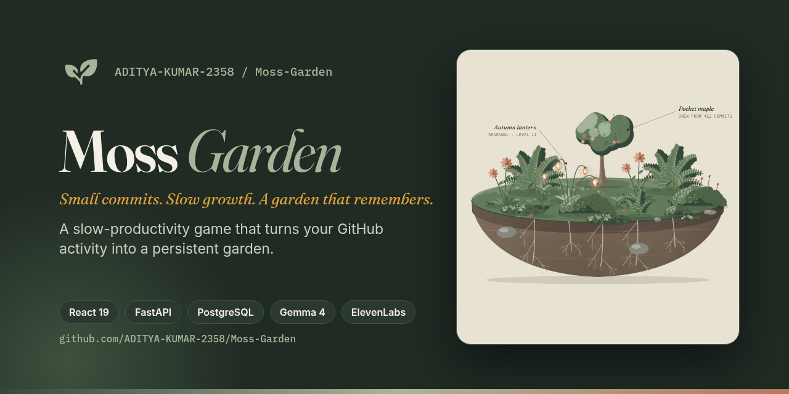

<p align="center">
  <a href="https://moss-garden-api.onrender.com">
    
  </a>
</p>

<p align="center">
  <a href="https://moss-garden-api.onrender.com"><strong>Live site</strong></a> ·
  <a href="docs/PRD.md">Product</a> ·
  <a href="docs/02-GAME-DESIGN.md">Game rules</a> ·
  <a href="docs/ARCHITECTURE.md">Architecture</a> ·
  <a href="docs/DESIGN.md">Design system</a> ·
  <a href="docs/DEPLOYMENT.md">Deploy</a> ·
  <a href="AGENTS.md">For coding agents</a>
</p>

# Moss Garden

**A slow-productivity game for developers.** Sign in with GitHub, pick the repositories that count, and every small commit you author grows a hand-drawn garden of moss, ferns, flowers and a young maple. The garden keeps everything it grows. There are no streaks to protect, no countdowns and nothing to lose.

Built for the DEV Hacktoberfest challenge *"Slow and Steady: build something with open-weight models or open-source AI that rewards laziness."*

<p align="center">
  
</p>

## Why

Contribution graphs and streak counters reward intensity. A missed day feels like a loss, a 2 a.m. push feels like a win, and the first broken streak is often the last day someone shows up. Moss Garden flips that:

- **Steady beats loud.** Each commit is worth less the more you push in one day, and daily XP is capped. Four quiet, cared-for days in a week earn a bonus that one long night cannot.
- **Rest is safe.** Lifetime XP never goes down. Quiet days only let the garden settle; plants never wilt and nothing resets. Come back after a month and it is all still there, with a "Came back" badge.
- **Progress is something to look at.** Plants grow through four stages, new species open with each level, seasons change the light, and badges glow gold when earned.

## Features

- **Your own GitHub account.** Read-only `read:user` access. Moss Garden never reads your code and never writes to GitHub.
- **A living garden.** XP, levels, vitality, six plant species with four growth stages, seasons, and a garden you can explore plant by plant.
- **Badges that shine.** Nine badges with real earned dates. Locked ones stay grey with a hint about how to earn them.
- **A weekly journal.** A calm few sentences about what grew. Plain summaries by default, or written by Gemma 4 when you turn the AI gardener on. It can be read aloud.
- **AI gardener, optional.** Gemma 4, an open-weight model, names new plants and writes the journal through Backboard. It is off until you switch it on, and it only sees garden counts and plant species.
- **Sound, optional.** Soft effects, music and seasonal ambience. Off by default, never autoplays.
- **Yours to keep or delete.** Profile, share card, JSON export and one-step deletion.
- **Light and dark themes**, responsive from 320 px phones to wide desktops, and every animation respects reduced motion.
- **Try it without signing in.** The demo garden is one click from the home page.

## How the garden grows

| You do | The garden does |
| --- | --- |
| Push a small commit | Earns up to 10 XP, weighted by a gentle message check |
| Push a second and third that day | Worth half, then a quarter. The day caps at 40 XP |
| Care for it on four days in one week | A one-time 15 XP steady-week bonus |
| Take a week off | Vitality settles to a floor of 20. Nothing is removed |
| Keep going | Plants mature, then bloom, then a new one is planted |

Full numbers: [`docs/02-GAME-DESIGN.md`](docs/02-GAME-DESIGN.md).

## Stack

| Layer | Tech |
| --- | --- |
| Frontend | React 19, Vite, Fraunces, Inter, IBM Plex Mono, Phosphor icons, layered SVG art |
| Backend | FastAPI, SQLAlchemy 2, Alembic, Pydantic Settings, cryptography (Fernet) |
| Data | PostgreSQL in production, SQLite locally |
| AI | Gemma 4 (`google/gemma-4-26b-a4b-it`) through Backboard, opt-in |
| Audio | ElevenLabs sound effects (pre-generated), browser read-aloud |
| Hosting | Render free web service and Postgres, GitHub Actions for keep-alive and the nightly sync |

## Run it locally

Requires Python 3.12 and Node 22.

```powershell
python -m venv .venv
.\.venv\Scripts\python.exe -m pip install -r backend\requirements-dev.txt
copy backend\.env.example backend\.env
```

In `backend/.env`, set `DATABASE_URL=sqlite:///./moss.db` (or a Postgres URL) and keep `DEMO_SEED=true`.

```powershell
cd frontend
npm install
npm run build
cd ..\backend
..\.venv\Scripts\python.exe -m alembic upgrade head
..\.venv\Scripts\python.exe -m uvicorn app.main:app --host 127.0.0.1 --port 8000
```

Open http://127.0.0.1:8000 and choose **Explore a demo garden**. For hot reload, run `npx vite` in `frontend/` and open http://127.0.0.1:5173.

To sign in with GitHub locally, either open the app and press **Approve GitHub sign-in** (it registers a GitHub App for you and writes the keys to `backend/.env`), or create an OAuth app with the callback `http://localhost:5173/auth/github/callback` and fill in `GITHUB_CLIENT_ID`, `GITHUB_CLIENT_SECRET`, `SESSION_SECRET` and `TOKEN_FERNET_KEY`.

Tests:

```powershell
cd backend
..\.venv\Scripts\python.exe -m pytest -q
```

## Deploy on Render

`render.yaml` creates a free Docker web service and a free Postgres database. The container runs migrations and then starts the server. The full guide, other hosts and a troubleshooting table are in [`docs/DEPLOYMENT.md`](docs/DEPLOYMENT.md).

1. Create a GitHub OAuth app. Homepage `https://<service>.onrender.com`, callback `https://<service>.onrender.com/auth/github/callback`. Leave "Expire user access tokens" unchecked.
2. In the Render dashboard set `GITHUB_CLIENT_ID`, `GITHUB_CLIENT_SECRET`, `SESSION_SECRET`, `TOKEN_FERNET_KEY` and `GITHUB_SCOPES=read:user`. Leave `GITHUB_OAUTH_CALLBACK_URL` empty.
3. In the GitHub repository settings (Secrets and variables, Actions) add the secret `SYNC_SECRET` with the same value as on Render and `RENDER_HEALTH_URL` as either a repository secret or variable, containing the public service URL or its `/healthz` URL. GitHub-hosted runners cannot read a local or Render `.env` file, so these must be configured in Actions. The workflows skip with a notice when either value is missing.
4. Optional AI: set `BACKBOARD_API_KEY`, `AI_ENABLED=true` and `AI_DAILY_REQUEST_BUDGET` above 0.

Generate the two server secrets with:

```powershell
python -c "import secrets; print(secrets.token_hex(32))"
python -c "from cryptography.fernet import Fernet; print(Fernet.generate_key().decode())"
```

Free Render Postgres expires 30 days after creation, and a free web service sleeps after 15 minutes without traffic. See [Render's free plan notes](https://render.com/docs/free).

## Privacy

Moss Garden reads the commits you authored in repositories you choose (date, message and ID), the names of those repositories, and your public profile. It never reads your code, never writes to GitHub, and never shares your activity. The AI gardener, when you turn it on, receives garden counts and plant species only. You can export everything as JSON or delete it from Settings.

## Docs

| Doc | What it covers |
| --- | --- |
| [`AGENTS.md`](AGENTS.md) | Start here if you are a coding agent: map, commands, rules that must hold |
| [`docs/PRD.md`](docs/PRD.md) | Problem, users, goals, feature status, requirements |
| [`docs/RULES.md`](docs/RULES.md) | Binding rules for anyone working on the project |
| [`docs/02-GAME-DESIGN.md`](docs/02-GAME-DESIGN.md) | XP, levels, vitality, plants, badges, seasons |
| [`docs/ARCHITECTURE.md`](docs/ARCHITECTURE.md) | Modules, data model, API, sign-in, sync, AI |
| [`docs/DESIGN.md`](docs/DESIGN.md) | Tokens, type, components, illustration, motion, voice |
| [`docs/DEPLOYMENT.md`](docs/DEPLOYMENT.md) | Render step by step, other hosts, troubleshooting |
| [`docs/MEMORY.md`](docs/MEMORY.md) | Decisions and hard-won facts, newest first |
| [`docs/TASKS.md`](docs/TASKS.md) | Build order, done, next, release checklist |
| [`docs/DECISIONS.md`](docs/DECISIONS.md) | Long-form reasoning behind decisions |
| [`docs/PROGRESS.md`](docs/PROGRESS.md) | Short status summary |
| [`docs/TESTING.md`](docs/TESTING.md) | Test coverage and the report workbook |

## Credits

Built by [Aditya Kumar](https://github.com/ADITYA-KUMAR-2358).
